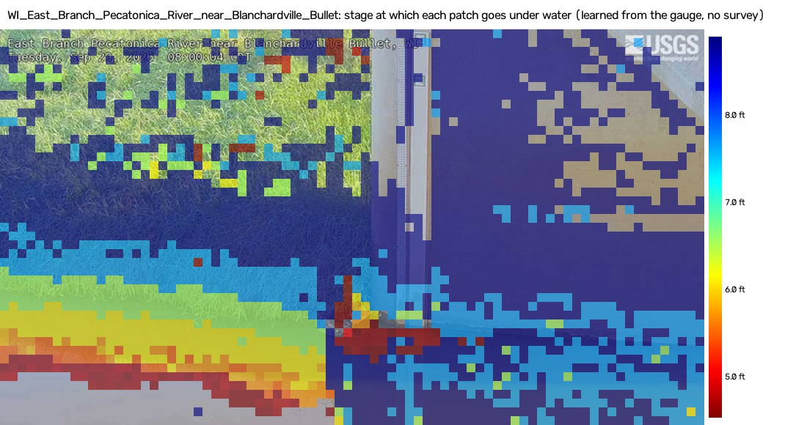

# RiverSight

**Public river webcams that read the water level, see the flood, and tell you when they can't be trusted.**
Entry for the OpenCV AI Competition 2026, powered by AWS.

RiverSight turns USGS HIVIS river webcams that sit beside an official stream gauge into calibrated water-level instruments, without a staff plate or a site survey. Every frame is registered to a per-site reference with OpenCV 5's learned ALIKED + LightGlue features and USAC_MAGSAC. A **scene model** learns from the gauge's own history which patches of the image flood at which stage. That gives a **flood-height map** for each camera, and a stage reading ± σ from any new daylight frame. A fleet of 20 calibrated cameras runs live on AWS Graviton with COOL. **River Steward**, a Bedrock agent, watches the fleet. It re-anchors cameras whose view changed, fills gauge outages with provisional camera readings, separates camera faults from suspect gauges, and on a rise draws what will be under water at the forecast crest and drafts an alert that a human approves.

**Live:** _URL added at gate G1 (Fri Oct 23)._ · **Report:** `report/REPORT.md` (in progress) · **Video:** _added at submission._

## What it does, in numbers (frozen protocol, test days read once)

Twenty cameras across the US (`data/sites/kill_test.yaml`). Test days Oct 4–14 2026 were held out, the setting was frozen and hashed before they were read (`results/constants.sha256`, D-0007), and they were scored exactly once (D-0002).

| | result | source |
|---|---|---|
| **Accuracy** | **14/20** sites meet MAE ≤ 0.25 ft or ≤ 10 % of the site's stage range; median MAE **0.182 ft** | `results/kill_test_v2.csv`, `results/kill_test_v2_summary.json` |
| **Gauge-outage gap-fill** | the camera beats the gauge's last-known value at **15/20** sites after a 72 h outage, **18/20** after 7 days | `results/kill_test_v2_summary.json` |
| **Registration** | **95.7 %** of 9,000 daylight frames registered; ORB alone manages 39.6 %, ALIKED + LightGlue recovers 4,892 frames | `results/kill_test/registration_summary.csv` |

Flood state (stage above the site's 90th percentile): median balanced accuracy **0.93**, vs 0.75 for a 24-hour-stale gauge, over the 9 sites with flood frames. Full table, per-site plots and caveats: [`results/kill_test_v2.md`](results/kill_test_v2.md).



_Flood-height map: each patch is coloured by the stage at which it goes under water, learned from the gauge's history. Image: USGS HIVIS, public domain; faces blurred with YuNet._

## Not claimed

- **Not a replacement for gauges or official warnings.** While the gauge is online, the camera beats a 15-minute-old gauge reading at **0/20** sites. The camera's value is when the gauge is down, stale or suspect, and in showing where the water is.
- **Daylight only.** Night and IR frames are not scored.
- **Needs gauge history.** Calibration uses months of the co-located gauge record, so it does not yet transfer to ungauged cameras.
- **Seasons drift.** Year-long forward-chaining CV gives median MAE **0.38 ft** (9/20 sites meet the accuracy bar), against 0.182 ft on the 10 test days (`results/scene/tune_cv_summary.csv`).
- **Cameras move.** 8/20 cameras have history periods that cannot be registered to the current view (`results/kill_test_v2_summary.json`). That is why view-change detection and re-anchoring are agent jobs.
- **Agent faults are partly synthetic.** Fault-injection episodes are labelled `real` or `synthetic` in `results/agent_eval/`.
- **Several accuracy passes are on quiet test windows** where simple baselines are better still; the per-site table shows them.

We are not the first camera water-level system (see `docs/PRIOR_ART.md`). Our claim is narrower: the first open, fleet-scale, plate-free and survey-free system, with a frozen held-out benchmark, a live endpoint and agentic QA.

## How it works

```
USGS NIMS frame ─► register (ALIKED + LightGlue + USAC_MAGSAC) ─► warpPerspective to reference
   ─► per-block Lab / Sobel features ─► flood-height-map ROI ─► kernel ridge ─► Kalman ─► stage ± σ
   ─► flags (VIEW_CHANGE, LOW_QUALITY, GAUGE_STALE, DISAGREE, RISING) ─► River Steward agent ─► human approval
```


Agent loop and component details: [`docs/ARCHITECTURE.md`](docs/ARCHITECTURE.md). Every OpenCV 5 call that carries weight, and what breaks without it: [`docs/OPENCV5_USAGE.md`](docs/OPENCV5_USAGE.md). COOL vs stock OpenCV on Graviton: `docs/COOL_BENCHMARK.md` (in progress).

## Quick start

Python ≥ 3.12. OpenCV is pinned to `opencv-python-headless==5.0.0.93`.

```bash
pip install -e ".[dev]"
pytest -q
cp .env.example .env                              # add USGS_API_KEY (free)
python report/summarize_results.py                # recompute the fleet summary from committed results
```

Fetching frames and refitting needs the local image cache. Full fresh-clone steps with timings: `docs/REPRODUCE.md` (in progress).

## Repo map

| path | what |
|---|---|
| `src/riversight/vision/` | registration cascade, scene features, YuNet privacy blur |
| `src/riversight/calib/` | flood-height map, kernel-ridge scene regressor |
| `src/riversight/eval/` | protocol v2 metrics |
| `src/riversight/live/` | live cycle on Graviton |
| `src/riversight/agent/` | River Steward: tools, rules policy, Bedrock loop |
| `scripts/` | fetch, features, tune, freeze, score (`scene_score.py` refuses to rerun the test days) |
| `results/` | committed evaluation outputs; every number in the docs comes from here |
| `bench/` | COOL benchmark harness |
| `infra/`, `web/` | AWS CDK stack, dashboard |
| `report/` | technical report and the summary script |
| `docs/` | plan, decisions (`DECISIONS.md`), interfaces, research |

## Data and credits

Images: USGS HIVIS / NIMS, public domain. Stage: USGS NWIS instantaneous values. We do not redistribute raw frames; derived demo overlays are face-blurred (YuNet). Licence: Apache-2.0.
