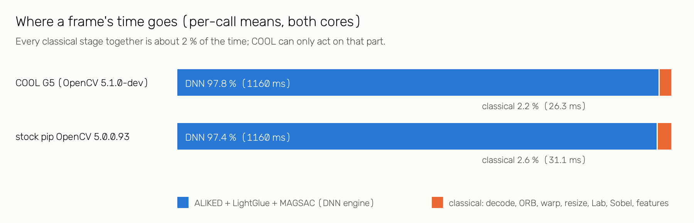

# RiverSight: public river webcams as calibrated water-level instruments

**Technical report, OpenCV AI Competition 2026 (powered by AWS).** Final, 2026-10-25 (a last update may follow on 2026-10-26 if the live deployment changes). Live: https://d2aes2r6og8aap.cloudfront.net. Every number here is generated from, or traceable to, a committed file in `results/` (`python scripts/check_report_numbers.py`).

## 1. Problem

The USGS runs hundreds of public HIVIS webcams that look at rivers next to official stream gauges. A gauge gives one number, stage in feet, every 15 minutes. When it goes down, nobody knows the water level at that site until a technician fixes it, and that can happen in the middle of a flood. When it reads wrong, nothing independent says so. The camera beside it is a second instrument that nobody reads, because pixels are not feet.

Existing camera water-level systems read a staff plate, need a surveyed site, or run on a single camera with hand tuning (`docs/PRIOR_ART.md`). None of them scale to a fleet of cameras that were never set up for measurement.

RiverSight reads stage from these cameras with no plate and no survey, by learning from the gauge's own history which parts of each scene go under water at which stage. It also checks itself: it notices when a camera has moved, when the lens is fogged, and when the camera and gauge disagree, and it hands those cases to an agent that a human supervises.

## 2. Users and decisions

Three people, each making a real decision with a camera they already have but cannot read. For each: what they see, the decision it supports, and what it does not replace.

**County emergency manager** (a flood-prone Texas county, say, with a USGS camera on a creek crossing).
- *Sees:* the site page with the latest frame and the wet area drawn on it; a status pill (OK, provisional, above range, night); a slider showing what is under water at any stage; the NWS forecast crest drawn into today's picture where a forecast exists; a drafted alert waiting for approval when the water rises.
- *Decision:* whether to close a low-water crossing or send a crew to look, especially when the gauge has gone silent or is hours old.
- *Does not replace:* NWS warnings or the county's own gauges and spotters. Alerts are drafted, never sent without a person. Above the calibrated range the camera says "at least X ft", not a number.

**NWS hydrologist or forecaster.**
- *Sees:* flood state per camera (above or below the site's 90th percentile), with σ; which gauges are stale or disagree with their camera; the fleet triage list ranked by what needs a human.
- *Decision:* whether a gauge reading feeding a forecast is trustworthy right now, and whether a site without a working gauge is rising.
- *Does not replace:* the gauge record, the rating curve or the forecast model. A camera reading is a provisional, independent check.

**USGS hydrographer at a water science center.**
- *Sees:* cameras flagged for a view change, quarantined or re-anchored, with the registration evidence; tickets saying "gauge suspect" when a confident camera disagrees with a flat-lining or jumping gauge; provisional gap-fill during an outage, with σ.
- *Decision:* which site to visit first; whether a gauge needs a check before its data is approved; which camera needs a new reference after a re-aim.
- *Does not replace:* field measurements or the approval of official records. Gap-filled values are labelled provisional and never written into the USGS record.

## 3. Architecture

Offline, each site is calibrated once from up to 12 months of frames and gauge readings. Live, one Graviton worker reads the newest frame of every served camera (the 20 frozen-test cameras plus the tier-B cameras onboarded since, §6.10) every 15 minutes, produces a stage ± σ plus quality flags, and writes it to S3 behind CloudFront. Flagged readings go to the River Steward agent. Details: `docs/ARCHITECTURE.md`.

## 4. OpenCV 5 implementation

Full table, with what breaks without each call: `docs/OPENCV5_USAGE.md`.

**Registration.** Every frame is registered to the site's reference: ORB + BFMatcher first, then, for the frames ORB cannot register, OpenCV 5.0's learned **ALIKED** features with the **LightGlueMatcher** (both new in 5.0, running on the new DNN engine), and a **USAC_MAGSAC** homography. The inlier ratio and reprojection error become the registration score that drives view-change detection.

**Scene model** (D-0006; setting frozen in D-0007).
1. `warpPerspective` puts the frame in reference geometry; `resize(INTER_AREA)` brings it to 320 × 180.
2. The frame is cut into 3,600 blocks of 4 px. Each block gets five features: Lab lightness (normalised per frame), a, b, `Sobel` gradient magnitude and lightness spread.
3. **Flood-height map.** For each block, a threshold h* on gauge stage is fitted so the block's features separate "stage below h*" from "stage above h*"; its accuracy is the block's reliability. Reliable blocks (≥ 0.80) form the region of interest. h* is also what the dashboard and the agent draw: every block with h* ≤ a given stage is under water at that stage.
4. A linear-kernel ridge regression (λ = 1) on the standardised ROI features gives a raw stage; a causal 1-D Kalman filter smooths it, and σ comes from out-of-fold residuals.

**QA and privacy.** Laplacian variance, glare and a dark-channel fog score flag bad frames; YuNet (`FaceDetectorYN`) blurs faces before any frame is published. `cv2.Animation` / `imwriteanimation` write the event GIFs.

**Connected inundation (display).** The slider and the wet overlay should show water only where water can be. A block is drawn as wet at stage s only if h* ≤ s, it is reliable, **and** it is 4-connected to the river through other such blocks. The seed is the lowest decile of h* inside the river corridor: the reliable component with the largest area × (centroid height)², because water lies low in a river camera's view while stray reliable specks on foliage or sky are small and high. The fill uses `cv2.connectedComponentsWithStats` on the 80 × 45 block grid (`live/bundle.py: connected_inundation`). It is display only: the stage estimate and every reported number use the unconnected model.

**Arm64.** The live path uses `INTER_AREA` only and pads with `copyMakeBorder` instead of `warpPerspective(BORDER_REPLICATE)`, avoiding two KleidiCV issues in the 5.0.0.93 arm64 wheels (#29794, #29816).

## 5. AWS deployment

Live at https://d2aes2r6og8aap.cloudfront.net since 2026-10-23, in us-east-2 (`docs/DEPLOY.md`, `infra/`).
- **Worker:** one EC2 m9g.large (Graviton5) from the **COOL G5 AMI**. A systemd timer runs one cycle over all calibrated cameras every 15 minutes. `/proof` publishes the instance-identity document, AMI id, `cv2.__file__`, version and `getBuildInformation()` hash, so a judge can check which OpenCV produced the readings.
- **Storage and front door:** a private S3 bucket (models, live readings, overlays, approvals) behind CloudFront with origin access control; the dashboard is static.
- **Agent:** for flagged readings only, a deterministic rules policy takes the actions using OpenCV evidence; Amazon Bedrock (Claude Sonnet 4.6 through the `us.` cross-region inference profile, Converse tool use) ranks the fleet, gives a recorded second opinion on anything that pages a human, and reviews suspected gauge drift. Claude Haiku 4.5 and Sonnet 4.6 were also evaluated as stand-alone deciders (agent evaluation section). Claude 5.5 models were not available to this AWS account.
- **Human approval:** a Lambda Function URL behind a token; SNS e-mail to the operator.
- **Guardrails:** an AWS Budget on the $100 cap (D-0004) whose 90 % action stops every instance tagged for the project, created before the first launch; IMDSv2; no SSH (SSM only); least-privilege roles.
- **Operations:** `docs/RUNBOOK.md` (worker down, USGS down, Bedrock throttled, tear-down).

## 6. Evaluation

### 6.1 Protocol

Pre-registered before any test frame was read (D-0006):
- 20 cameras chosen for gauge history and view variety (`data/sites/kill_test.yaml`).
- Calibration: all frames before 2026-10-03 00Z (history up to 12 months, minimum 90 days). Tuning only by forward-chaining CV inside the calibration data: 36 settings, selection rule committed before any CV result existed (D-0007).
- The chosen setting and every scoring module were hashed (`results/constants.sha256`) before the test days were read.
- Test: daylight frames, 2026-10-04 00Z to 2026-10-14 00Z, scored **once** (worker-q job 2986, `scripts/scene_score.py`, which refuses to run a second time).
- Pass criteria: **P1** ≥ 10/20 sites with MAE ≤ 0.25 ft or nMAE ≤ 10 % of the calibration p5–p95 stage range; **P2** the camera beats a 24-hour-stale gauge on event frames at ≥ 70 % of sites with events; **P3** registration ≥ 90 %.

### 6.2 Headline results (verdict: PASS)

<!-- BEGIN:headline -->
| metric | value | source |
|---|---|---|
| P1 accuracy (MAE ≤ 0.25 ft or nMAE ≤ 10 %) | **14/20** sites (bootstrap 95 % interval 12–16) | `kill_test_v2_verdict.json`, `kill_test_v2_ci_summary.json` |
| median MAE across sites | **0.182 ft** (95 % CI 0.148–0.22) | `kill_test_v2_ci_summary.json` |
| median nMAE / Spearman ρ | 0.092 / 0.66 | `kill_test_v2_summary.json` |
| P2 value on event frames vs 24 h-stale gauge | **15/16** event sites | `kill_test_v2_verdict.json` |
| P3 registration, 30-day daylight frames | **95.7 %** (8611 of 9000) | `kill_test/registration_summary.csv` |
| flood-state balanced accuracy, median over 9 sites with flood frames | **0.93** vs 0.75 (24 h-stale gauge) | `kill_test_v2_summary.json` |
| coverage: daylight hours with a reading, median site | 94.1 % (47.5 % of all hours) | `coverage_v2.csv` |
| fleet camera-hours of stage per day | 219.4 | `kill_test_v2_ci_summary.json` |
<!-- END:headline -->

CIs are a block bootstrap over test days (`report/bootstrap_coverage.py`). "Covered" means at least one frame in that hour produced a reading.

### 6.3 Per site

<!-- BEGIN:per_site -->
| site | tier | frames | MAE ft [95% CI] | RMSE ft | nMAE | P1 | event MAE: camera / 24 h LKV | daylight hours covered |
|---|---|---|---|---|---|---|---|---|
| Cowhouse Ck at Old Georgetown Rd nr Ft Hood (TX) | C | 236 | 0.212 [0.141–0.320] | 0.288 | 0.15 | ✔ | 0.64 / 1.01 | 100.0 % |
| Tenmile Ck at Parkinson Rd nr Ferris (TX) | C | 119 | 0.617 [0.539–0.679] | 0.685 | 0.33 | ✘ | 0.20 / 0.84 | 90.8 % |
| Buffalo Bayou at State HWY 6 near Addicks (TX) | B | 113 | 0.268 [0.182–0.364] | 0.353 | 0.09 | ✔ | 0.23 / 1.06 | 85.8 % |
| Clear Fk Trinity Rv at Ft Worth (TX) | B | 120 | 0.133 [0.098–0.179] | 0.171 | 0.11 | ✔ | 0.20 / 0.91 | 91.7 % |
| White Rk Ck at Greenville Ave Dallas (TX) | C | 58 | 0.782 [0.695–0.880] | 0.833 | 0.72 | ✘ | 0.56 / 0.52 | 40.8 % |
| Langham Creek at Addicks Reservoir Outflow near Addicks (TX) | B | 211 | 0.487 [0.384–0.569] | 0.661 | 0.10 | ✘ | 0.57 / 2.02 | 95.0 % |
| East Branch Pecatonica River near Blanchardville Bullet (WI) | A | 113 | 0.091 [0.071–0.115] | 0.108 | 0.02 | ✔ | 0.07 / 0.34 | 94.2 % |
| Swan Creek at Lalor Road near Fitchburg (WI) | C | 113 | 0.060 [0.046–0.076] | 0.073 | 0.04 | ✔ | — | 94.1 % |
| Root River near Pilot Mound (MN) | C | 94 | 0.451 [0.362–0.541] | 0.482 | 0.10 | ✘ | — | 78.3 % |
| East Branch Delaware River at Hancock Staff (NY) | A | 114 | 0.065 [0.049–0.081] | 0.087 | 0.04 | ✔ | 0.07 / 0.59 | 95.0 % |
| Neversink River at Godeffroy (NY) | B | 114 | 0.060 [0.036–0.095] | 0.086 | 0.04 | ✔ | 0.11 / 0.51 | 95.0 % |
| Stony Brook at Princeton (NJ) | B | 111 | 0.106 [0.074–0.145] | 0.138 | 0.06 | ✔ | 0.13 / 1.09 | 92.5 % |
| Big Brook near Marlboro (NJ) | C | 58 | 0.146 [0.103–0.200] | 0.173 | 0.17 | ✔ | 0.11 / 0.40 | 48.3 % |
| East Fork Little Miami River at Perintown (OH) | B | 120 | 0.475 [0.359–0.588] | 0.545 | 0.11 | ✘ | — | 94.8 % |
| Bean Creek at Powers (OH) | B | 113 | 0.270 [0.204–0.339] | 0.312 | 0.05 | ✔ | 0.22 / 0.58 | 89.6 % |
| Animas River at Durango (CO) | B | 230 | 0.152 [0.113–0.185] | 0.167 | 0.07 | ✔ | 0.02 / 0.29 | 100.0 % |
| Sand Creek at Mouth nr Commerce City (CO) | C | 237 | 0.069 [0.060–0.078] | 0.080 | 0.09 | ✔ | — | 100.0 % |
| Salt Creek at Wood Dale (IL) | B | 119 | 0.091 [0.065–0.118] | 0.121 | 0.02 | ✔ | 0.14 / 0.90 | 99.1 % |
| Brandywine Creek at Chadds Ford (PA) | C | 233 | 0.308 [0.210–0.405] | 0.387 | 0.19 | ✘ | 0.37 / 1.92 | 99.2 % |
| First Mallard Branch nr Fairfield (CA) | B | 208 | 0.391 [0.308–0.478] | 0.523 | 0.09 | ✔ | 0.35 / 0.58 | 90.8 % |
<!-- END:per_site -->

Per-site time series and flood-height maps: `results/kill_test_v2/`. Tiers follow pre-registered rules (D-0007): A = sites with a staff plate or structure in view, C = poor test-day registration, weak CV correlation or under 90 calibration days.

### 6.4 Against baselines: where the camera adds value

<!-- BEGIN:baselines -->
| comparison (all scored frames unless noted) | camera better at |
|---|---|
| constant (calibration median) | 16/20 |
| gauge 24 h stale (persistence) | 10/20 |
| gauge 15 min stale (persistence) | 0/20 |
| event frames (\|Δ24h\| ≥ 0.25 ft): gauge 24 h stale, P2 | 15/16 event sites |
| gauge outage of 6 h: last-known value | 3/20 |
| gauge outage of 24 h: last-known value | 10/20 |
| gauge outage of 72 h: last-known value | 15/20 |
| gauge outage of 7 days: last-known value | 18/20 |
<!-- END:baselines -->

The camera never beats a 15-minute-old gauge reading. Its value appears when the gauge is down or stale: after a 72-hour outage it beats the last known value at most sites, and after 7 days at nearly all. That is the product claim: **gap-fill during gauge outages, flood state, and camera QA**, not live replacement.

### 6.5 Ablations and harder settings

**Registration, per site.** ORB alone fails on most cameras; ALIKED + LightGlue carries the cascade. Over the 12-month history, a bank of per-view references (one per run of frames the main reference could not register) adds little at fleet scale: it matters at the two cameras that were re-aimed most (Pecatonica, Sand Creek), which is why re-anchoring is an agent action and not a default (`report/registration_ablation.py`).

<!-- BEGIN:registration -->
| site | 30 d: ORB | + ALIKED+LightGlue | + chaining | 12 mo: main reference | + reference bank | usable for calibration |
|---|---|---|---|---|---|---|
| Cowhouse Ck at Old Georgetown Rd nr Ft Hood (TX) | 43.3 % | 99.7 % | 99.7 % | 97.2 % | 97.2 % | 97.2 % |
| Tenmile Ck at Parkinson Rd nr Ferris (TX) | 45.7 % | 100.0 % | 100.0 % | 99.1 % | 99.1 % | 99.1 % |
| Buffalo Bayou at State HWY 6 near Addicks (TX) | 28.0 % | 98.9 % | 98.9 % | 95.2 % | 95.2 % | 95.2 % |
| Clear Fk Trinity Rv at Ft Worth (TX) | 35.3 % | 99.2 % | 99.2 % | 98.4 % | 98.4 % | 98.4 % |
| White Rk Ck at Greenville Ave Dallas (TX) | 19.4 % | 72.9 % | 79.5 % | 49.8 % | 49.8 % | 42.5 % |
| Langham Creek at Addicks Reservoir Outflow near Addicks (TX) | 10.5 % | 99.0 % | 99.0 % | 99.2 % | 99.2 % | 99.2 % |
| East Branch Pecatonica River near Blanchardville Bullet (WI) | 4.5 % | 85.5 % | 85.5 % | 61.6 % | 75.5 % | 61.8 % |
| Swan Creek at Lalor Road near Fitchburg (WI) | 36.4 % | 93.8 % | 93.8 % | 96.8 % | 96.8 % | 96.8 % |
| Root River near Pilot Mound (MN) | 19.6 % | 89.9 % | 91.8 % | 75.6 % | 75.6 % | 73.9 % |
| East Branch Delaware River at Hancock Staff (NY) | 100.0 % | 100.0 % | 100.0 % | 99.8 % | 99.8 % | 99.8 % |
| Neversink River at Godeffroy (NY) | 78.7 % | 98.1 % | 98.1 % | 97.0 % | 97.0 % | 97.0 % |
| Stony Brook at Princeton (NJ) | 40.3 % | 92.2 % | 92.2 % | 94.0 % | 94.0 % | 94.0 % |
| Big Brook near Marlboro (NJ) | 3.5 % | 55.6 % | 71.3 % | 22.3 % | 22.3 % | 20.8 % |
| East Fork Little Miami River at Perintown (OH) | 89.7 % | 100.0 % | 100.0 % | 99.4 % | 99.4 % | 99.4 % |
| Bean Creek at Powers (OH) | 62.6 % | 93.3 % | 93.6 % | 94.1 % | 94.1 % | 94.1 % |
| Animas River at Durango (CO) | 11.6 % | 98.5 % | 99.7 % | 99.5 % | 99.5 % | 99.5 % |
| Sand Creek at Mouth nr Commerce City (CO) | 10.1 % | 92.6 % | 99.9 % | 26.3 % | 32.8 % | 26.3 % |
| Salt Creek at Wood Dale (IL) | 41.6 % | 98.9 % | 98.9 % | 47.4 % | 47.4 % | 46.7 % |
| Brandywine Creek at Chadds Ford (PA) | 99.6 % | 99.7 % | 99.7 % | 92.6 % | 92.6 % | 92.6 % |
| First Mallard Branch nr Fairfield (CA) | 26.7 % | 93.0 % | 93.0 % | 83.9 % | 85.8 % | 80.9 % |
| **fleet** (9000 / 38668 daylight frames) | **39.6 %** | **94.0 %** | **95.7 %** | **80.5 %** | **81.4 %** | **79.6 %** |
<!-- END:registration -->

<!-- BEGIN:ablations -->
| ablation | result | source |
|---|---|---|
| registration: ORB + MAGSAC alone vs full cascade | 39.6 % vs 95.7 % of 9000 daylight frames; ALIKED + LightGlue recovered 4892 frames | `kill_test/registration_summary.csv` |
| estimator: classical transect waterline vs scene model, 20-day fit-window CV, sites ≤ 0.25 ft | 1/20 vs 9/19 (scene median 0.278 ft) | `kill_test/fit_window_cv.csv`, `scene/gate_fit20.csv` |
| calibration horizon: year-long forward-chaining CV (frozen setting) | P1 at 9/20, median MAE 0.38 ft, median nMAE 0.145; 36 settings tried | `scene/tune_cv_summary.csv` |
<!-- END:ablations -->

The year-long CV is the honest long-run number. Its error is about twice the test-day error. Two causes are confounded: the scene changes through the year (vegetation, sun angle, sediment), and the early folds train on only one or two months (`results/failures/seasonal_monthly_mae.csv`). Periodic recalibration is planned for the live models (they are refit on all data up to export, and never mixed into the frozen numbers).

### 6.6 Head-to-head at Hancock, NY

StageSight, another entry, reads the staff plate on the same USGS camera (Hancock NY, 01421500) and reports two floods. The two systems make different assumptions: StageSight needs a red-marked plate in view and no gauge history; RiverSight needs gauge history and no plate. To compare fairly we refit our scene model with the frozen setting on all calibration frames **except ±7 days around each event** (leave-event-out), and score the event's registered daylight frames against the gauge (`report/headtohead_hancock.py`, `results/headtohead_hancock/`). Our windows are the UTC days of each event; StageSight's exact frame sets may differ.

<!-- BEGIN:hancock -->
| | 29–30 Jul 2026 flood | 4–5 Sep 2026 |
|---|---|---|
| gauge range in window, ft | 9.56–18.08 | 10.87–11.97 |
| our calibration max after leaving the event out, ft | 11.97 | 18.08 |
| **RiverSight RMSE, ft [95 % CI]** | 4.32 [3.44–5.07] | 0.46 [0.36–0.54] |
| RiverSight MAE / within 0.5 ft | 3.29 / 21.4 % | 0.39 / 61.5 % |
| RiverSight flood-state recall (camera above calibration p90 when the gauge is) | 1.00 | 0.92 |
| baseline: gauge value at window start held (outage at event start), RMSE | 5.53 | 0.41 |
| baseline: calibration median, RMSE | 5.40 | 1.76 |
| RiverSight coverage: hours of the window / listed daylight frames with a reading | 58.3 % / 93.3 % | 54.2 % / 100.0 % |
| StageSight RMSE as reported, ft (not reproduced by us) | 0.26 [0.20–0.31] | 0.34 |
| StageSight coverage as reported | 2.4 % of hourly frames (whole archive) | |
<!-- END:hancock -->

**Reading this honestly.**
- On the moderate September event we are worse than StageSight's reported figure, and slightly worse than simply holding the gauge's value from the start of the event.
- On the July flood we fail: with that flood left out, the calibration never saw a stage above 11.97 ft, and the scene model cannot extrapolate. It saturates near its calibrated ceiling while the river rises above it. Its Kalman σ stays small, so it is confidently wrong.
- What survives is flood state: the camera put itself above the calibration p90 on every July frame where the gauge was there.
- A plate reader measures stages it has never seen; a model calibrated from history does not. This is the main limitation of the approach (§7). The live system now has to flag readings at the edge of the calibrated range instead of reporting them as numbers.
- Future work: every flood the gauge records could extend the camera's calibrated range, because the site bundle can be refit on new data. Today that refit is a manual export (`scripts/export_site_models.py`), not a scheduled job.
- Our advantage is elsewhere: 20 cameras without plates, and coverage of most daylight hours, against 2.4 % of hourly frames reported for the plate reader.

### 6.7 Agent evaluation (River Steward)

W2's frozen evaluation (`results/agent_eval/REPORT.md`, `LLM_ANALYSIS.md`): every arm runs every episode; task success = the right primary action without forbidden ones. Claude models through Amazon Bedrock (the 5.5 models were not yet available to the project, so the evaluation used Claude Sonnet 4.6 and Haiku 4.5).

<!-- BEGIN:agent -->
| arm | model | repeats | task success (min–max) | real / synthetic | false actions on clean controls | fleet triage top-1 | p50 latency s | est. $ total |
|---|---|---|---|---|---|---|---|---|
| deterministic rules | — | 3 | 92.6 % (92.6–92.6) | 95.9 % / 85.7 % | 0.0 % | 83.3 % | 0.8 | 0.0 |
| LLM agent + OpenCV tools | Claude Sonnet 4.6 | 1 | 71.4 % (71.4–71.4) | 79.4 % / 57.1 % | 3.8 % | 100.0 % | 55.7 | 5.128 |
| LLM agent + OpenCV tools | Claude Haiku 4.5 | 3 | 58.8 % (56.1–61.2) | 54.5 % / 66.7 % | 7.7 % | 44.4 % | 42.0 | 4.326 |
| LLM agent, flags only (no OpenCV evidence) | Claude Haiku 4.5 | 3 | 51.4 % (49.0–55.1) | 47.6 % / 58.1 % | 15.4 % | 52.8 % | 41.2 | 4.126 |

Episodes: 108 single-camera (73 real, 35 synthetic and labelled, 26 clean controls) + 12 fleet cycles; expected actions written before any arm ran; set frozen with sha256 (`results/agent_eval/FROZEN.json`). OpenCV-evidence effect (same LLM with vs without OpenCV tools, paired): +7.5 points (95 % CI -1.4 to 16.3).

Like-for-like, every arm on the same 98 frozen v3 episodes (task success, min–max over repeats):

| arm | task success |
|---|---|
| **hybrid: rules act, Sonnet 4.6 advises** | 94.6 % (93.9–94.9) |
| deterministic rules | 93.9 % (93.9–93.9) |
| Sonnet 4.6 agent | 71.4 % (71.4–71.4) |
| Haiku 4.5 agent | 58.8 % (56.1–61.2) |
| Haiku 4.5, flags only | 51.4 % (49.0–55.1) |

Hybrid on the extended v4 set (adds tidal episodes): 93.2 % task success, 0.0 % false actions on clean controls, fleet triage top-1 86.1 %, p50 latency 0.8 s, about $3.124 for the whole run. Sonnet's gauge-drift reviews turned 2 of 9 drift episodes into a human-approved gauge-suspect ticket; its recorded second opinions agreed with the rules 94.4 % of the time (36 decisions) and never override them.

Tidal sites (v4): ordinary tides correctly not alerted 21/21; the replayed live false alert suppressed 3/3; record-high (king-tide) days alerted 0/6.
<!-- END:agent -->

**Autonomy set by measurement (D-0012).** We tested whether an LLM should drive the fleet. On 98 frozen episodes it should not act alone: 71.4 % (Sonnet 4.6) and 58.8 % (Haiku 4.5) task success, against 93.9 % for the deterministic, OpenCV-grounded rules. It does add value where the rules are blind, notably on gauge drift and offset and on ranking the fleet for a human. So the live split is: **OpenCV-grounded rules act** (reversible actions, or paging a human); **the LLM advises** (Sonnet 4.6 ranks the fleet, records a second opinion on every human-facing decision, reviews gauge-drift suspicions and drafts the alert text); **a human approves** anything external. The hybrid policy was defined before it was evaluated on the same frozen episodes (W2).

**Reading this honestly.**
- The deterministic rules policy beats both LLM agents on this episode set. The rules were written by the same people who wrote the expected actions, so this partly measures agreement with the authors, but it is still the best policy we have: the live system decides with rules first.
- The OpenCV evidence clearly matters where the decision depends on what the image shows. With the tools, the LLM re-anchors to a banked reference, recognises night frames and keeps muddy-water frames during a stale gauge. The overall effect is positive, but its confidence interval includes zero, and on gauge flatlines the evidence misleads the LLM.
- The LLMs' main failure is under-escalation: missing `DRAFT_ALERT` on real rises. Out-of-range readings were the other common miss. The LLM is therefore used as a second opinion on hard cases, never as the only decider (Q-0011).
- **The hybrid, defined before it was run, is the best arm:** OpenCV-grounded rules act and Claude Sonnet 4.6 advises. It turned some gauge-drift cases that the rules alone miss into human-approved tickets (2 of 9), and it never overrides the rules on its own. The margin over rules alone is small.
- **A documented false alert.** On Oct 24 a live `DRAFT_ALERT` at First Mallard Branch, a tidal slough, was approved by a human: an ordinary tide had crossed the 3-hour rise rule. The fix marks tidal sites and judges a rise against the site's tidal envelope instead. Replayed, that false alert is now suppressed, and ordinary tides no longer alert. King tides that the harmonic model predicts also no longer alert. Cowork then asked for a low-severity king-tide advisory (D-0014). It was pre-registered and run as episode set v5 (`results/agent_eval/V5_TIDE_RECAL.md`), and it **does not work**: it caught 0 of 4 real king tides at Savannah and fired on 1 of 13 ordinary tides. The forecast times the high water well but predicts it 0.2–0.7 ft too low, because Savannah's highest tides include river flow and wind that four tidal constituents cannot predict. It ships switched off and is reported as a negative result. The approved First Mallard alert stays in the log.
- **Recalibration as an agent action:** `RECALIBRATE` drafts a refit for human approval when W4's drift signal or a flood-extended range calls for it. It passed all 30 synthetic v5 runs and stayed silent when it should; the live drift signal exists only once the recalibration wiring is deployed.
- **Camera-health QA** (a daily fleet report, rendered at `/health`; every item is a ticket draft that needs a human, nothing is sent). Version 2 was evaluated over about a year of history at 59 cameras (`results/agent_eval/HEALTH_EVAL.md`):
  - **Offline cameras:** 315 outages at 34 of 59 sites, counted from the upload record itself.
  - **Lost view:** recall 0.715 against independent history segments. It also fires on bad-weather days.
  - **Stuck in IR by day:** 16 days confirmed by a chroma test; 7 of 7 sampled were real faults. Version 1 was 0 of 12, every one a snowy day.
  - **Poor visibility:** it cannot tell a dirty lens from fog or fresh snow, so it is reported as "weather or lens" at low severity. We do not claim dirty-lens detection.
- Flood replays through the live cycle drafted an alert in the first cycle above the site's p90 (`results/agent_eval/replay/`).
- Limits (from W2): gauge-stale episodes are synthetic dropouts on real frames; re-anchoring is tested mostly on one camera (Pecatonica); costs are list-price estimates.

### 6.8 COOL on Graviton

**Fleet cost first:** one Graviton5 m9g.large running COOL covers all ~880 gauged HIVIS cameras at a 15-minute cadence for about **$0.06 per camera-month**, with provenance recorded for every number (instance identity, AMI, `cv2.__file__`, build hash).

COOL G5 vs stock pip OpenCV 5.0.0.93 on the same m9g.large, same Python and numpy, the live per-frame path stage by stage plus the fleet cycle (`results/cool_bench/cool_g5_m9g_2026-10-24/`; full tables and method: `docs/COOL_BENCHMARK.md`).

| | COOL vs stock |
|---|---|
| fleet cycle, 880 frames, 2 cores | 1.0067× (1.4029 vs 1.3936 frames/s) |
| ORB + MAGSAC registration, 1 / 2 threads | 1.16× / 1.21× |
| whole per-frame path, p50, 1 / 2 threads | 1.13× / 1.21× |
| resize, cvtColor, Sobel, warpPerspective, imdecode | 0.975× – 1.011× |
| ALIKED + LightGlue (≈ 98 % of stage time) | 0.996× / 0.999× |
| outputs | bit-identical pixels; stage estimates within 0.00044 ft |
| $ per camera-month at 15 min, incl. COOL fee | $0.0586 vs $0.0562 |
| one m9g.large covers | ~880 cameras at 15 min (627 s per cycle) |

Honest reading: end to end, COOL is flat on this workload, because the cycle is dominated by the learned matcher, which COOL does not speed up. The stock aarch64 wheel already ships KleidiCV, and our images are small. COOL's real gain is in ORB registration, which most frames go through. Because the outputs are identical and the cost difference is a fraction of a cent per camera-month, the live worker runs COOL. The whole gauged HIVIS fleet fits on one Graviton instance either way.

### 6.9 Prospective live evaluation

Pre-registered in D-0010 §1 before the first COOL cycle: the live bundles as first deployed (`results/live_prospective/frozen_models.json`) are scored on every daylight reading with registration OK, against the USGS reading closest in time, until the code freeze. Saturated (`OUT_OF_RANGE`) readings are counted, not scored. Baseline: the gauge's value 24 hours earlier. Forward in time, out of sample, reported whatever it shows; refreshed from `results/live_prospective/` (W1, `scripts/score_prospective.py`).

<!-- BEGIN:prospective -->
Window: 2026-10-23 21:28 UTC (first COOL cycle) to 2026-10-24 21:17 UTC so far; submission cut 2026-10-26 17:00 UTC. Models: frozen live models (results/live_prospective/frozen_models.json). Match: closest USGS IV reading within ±20 min of the frame. The camera beats a 24-hour-old gauge value at 0 of 16 scored sites so far. That matches the frozen test: in quiet conditions persistence is hard to beat; the camera's value is outages, flood state and QA.

| | readings | daylight | scored | saturated (gauge trusted) | coverage | camera MAE ft | median AE ft | within ±0.25 ft | 24 h last-known MAE ft |
|---|---|---|---|---|---|---|---|---|---|
| **fleet** | 690 | 382 | 300 | 2 | 78.5 % | 0.241 | 0.19 | 57.0 % | 0.056 |
| Sand Creek at Mouth nr Commerce City (CO) | 48 | 45 | 44 | 0 | 97.8 % | 0.056 | 0.023 | 100.0 % | 0.042 |
| Cowhouse Ck at Old Georgetown Rd nr Ft Hood (TX) | 92 | 42 | 42 | 0 | 100.0 % | 0.115 | 0.116 | 97.6 % | 0.006 |
| Brandywine Creek at Chadds Ford (PA) | 92 | 43 | 41 | 0 | 95.3 % | 0.351 | 0.351 | 9.8 % | 0.017 |
| First Mallard Branch nr Fairfield (CA) | 48 | 46 | 41 | 2 | 89.1 % | 0.353 | 0.307 | 34.1 % | 0.183 |
| Langham Creek at Addicks Reservoir Outflow near Addicks (TX) | 92 | 40 | 39 | 0 | 97.5 % | 0.494 | 0.476 | 2.6 % | 0.098 |
| Buffalo Bayou at State HWY 6 near Addicks (TX) | 23 | 10 | 10 | 0 | 100.0 % | 0.290 | 0.298 | 30.0 % | 0.038 |
| Salt Creek at Wood Dale (IL) | 24 | 11 | 10 | 0 | 90.9 % | 0.079 | 0.049 | 90.0 % | 0.048 |
| Swan Creek at Lalor Road near Fitchburg (WI) | 23 | 10 | 10 | 0 | 100.0 % | 0.140 | 0.143 | 100.0 % | 0.008 |
| Tenmile Ck at Parkinson Rd nr Ferris (TX) | 23 | 10 | 10 | 0 | 100.0 % | 0.113 | 0.095 | 80.0 % | 0.007 |
| Stony Brook at Princeton (NJ) | 23 | 10 | 9 | 0 | 90.0 % | 0.220 | 0.241 | 55.6 % | 0.047 |
| Clear Fk Trinity Rv at Ft Worth (TX) | 23 | 10 | 9 | 0 | 90.0 % | 0.218 | 0.179 | 77.8 % | 0.020 |
| Neversink River at Godeffroy (NY) | 23 | 10 | 9 | 0 | 90.0 % | 0.061 | 0.061 | 100.0 % | 0.026 |
| Bean Creek at Powers (OH) | 23 | 10 | 8 | 0 | 80.0 % | 0.384 | 0.351 | 37.5 % | 0.015 |
| East Branch Delaware River at Hancock Staff (NY) | 20 | 9 | 8 | 0 | 88.9 % | 0.048 | 0.053 | 100.0 % | 0.027 |
| Root River near Pilot Mound (MN) | 21 | 11 | 8 | 0 | 72.7 % | 0.209 | 0.157 | 62.5 % | 0.045 |
| White Rk Ck at Greenville Ave Dallas (TX) | 23 | 10 | 2 | 0 | 20.0 % | 0.461 | 0.461 | 0.0 % | 0.025 |

Flags raised: VIEW_CHANGE 42, LOW_QUALITY 69, GAUGE_STALE 0, DISAGREE 47, RISING 77, OUT_OF_RANGE 49. Agent actions: DENSIFY 75, NOOP 58, QUARANTINE 39, OPEN_TICKET 18, MARK_PROVISIONAL 15, DRAFT_ALERT 4.

Model v2 in shadow on the same live frames: median absolute error 0.084 ft vs 0.183 ft for v1, the model served at the time, on 249 paired readings (§6.11).
<!-- END:prospective -->

### 6.10 Onboarding new cameras and real gauge outages

**Onboarding beyond the 20 (W5, `results/onboarding/README.md`).** One command per camera (`scripts/onboard_site.py`) fetches 12 months of frames and gauge data, builds a reference, registers, extracts features, runs the same forward-chaining CV and assigns a tier with the frozen D-0007 setting, with no per-site tuning. Two batches were onboarded on Oct 24–25, chosen for diversity (large rivers, creeks, cold-climate and tidal/coastal sites). They are not part of the frozen test.
- 90 cameras onboarded: **64 tier B** (eligible to serve) and 26 tier C (registration under 80 % or weak correlation).
- Tier B: median CV MAE 0.86 ft, median nMAE 0.143. That is about the frozen 20-site CV's nMAE (0.145); the absolute error is larger because many of these rivers have stage ranges of many feet.
- Qualifying rate by camera type: large rivers 80 % (32 of 40), tidal/coastal 73 % (8 of 11), creeks 65 % (11 of 17), cold-climate 59 % (13 of 22).
- As with the first 20, the camera beats a 24-hour-old gauge value at only 9 of 64 tier-B sites. It is a gap-filler, not a replacement.
- Cost per new camera (median of 90): 73 CPU-minutes and about 141 MB of frames, about $0.059 at m9g.large on-demand; 0.79 cameras onboarded per CPU-hour. Projected to all 880 gauged HIVIS cameras: about $52 of compute and 124 GB of frames.
- One onboarded camera, the Pee Dee River near Florence SC, sits beside a gauge that has been dark since 2026-06-30. It is served live as a real, ongoing gap-fill example (W5).

**How much gauge history does a new camera need?** For each of 29 sites, refit on only the last N days before the same two test months:

<!-- BEGIN:fewshot -->
| days of calibration | 14 | 30 | 60 | 90 | 180 | 365 |
|---|---|---|---|---|---|---|
| median MAE ft | 0.747 | 0.515 | 0.529 | 0.532 | 0.537 | 0.513 |
| median nMAE | 0.130 | 0.107 | 0.108 | 0.113 | 0.124 | 0.122 |
| P1 sites (of 29) | 13 | 16 | 17 | 17 | 13 | 16 |
<!-- END:fewshot -->

About a month of overlap with the gauge is enough. More history does not help the frozen setting, which matches the drift in §6.13.

**Real gauge outages** (W5, `results/real_outages/README.md`).
- **How often:** over the last 12 months, 531 of the 875 gauges behind gauged HIVIS cameras had at least one outage of 6 h or more: 3,734 outages, median 15.0 h, 984 lasting a day or more and 303 a week or more. For 1,241 of the 2,044 outages checked, the camera kept posting daylight frames while the gauge was dark.
- **How the camera did,** scored at the moment the gauge came back, against holding the last known value. Two variants:
  - *causal*: refit only on data before the outage, which is what a live system could do;
  - *hindsight reconstruction*: excludes the outage ± 7 days but uses data after it.
- Most outages are on a quiet river. In 73 of 102 hindsight-scored gaps the river moved less than 0.25 ft, and holding the last reading is nearly exact.
- **Where the river moved 0.25 ft or more,** the camera was closer than the last known value in **11 of 19** gaps (causal) and **18 of 29** (hindsight).
  - The clearest win: during a 44-day estimated outage on the Clearwater River at Spalding, the camera's MAE was 0.98 ft against 1.80 ft for the last known value (hindsight refit).
  - There are losses too, for example a winter ice gap on the Root River.
- So the camera helps when the river moves while the gauge is dark, which is when a fill-in matters. It wins in more of those cases than it loses, but not all of them.

### 6.11 Model v2: DINOv2 features in `cv2.dnn` (serving since Oct 27)

W4 (`results/v2/README.md`). v2 adds a second view of each registered frame: DINOv2-S/14 patch tokens computed by OpenCV 5's DNN engine (`cv2.dnn.readNetFromONNX`; checked against onnxruntime). The tokens go through a fixed, label-free PCA fitted on cameras outside the evaluation, then get the same flood-height-map reliability selection and ridge, combined with v1 at equal weight. Every other knob is the frozen D-0007 setting. It was evaluated with exactly the D-0007 protocol (monthly forward-chaining CV inside the calibration history; v1 reproduces the frozen numbers exactly), and the selection rule was committed before any v2 result existed.

<!-- BEGIN:model_v2 -->
| year-long forward-chaining CV, 20 sites | v1 (D-0007) | v2 selected (`v1+dino_roi@0.5+sun`) |
|---|---|---|
| median MAE ft | 0.380 | **0.252** (-33.7 %) |
| mean MAE ft | 0.389 | 0.304 |
| median nMAE | 0.145 | 0.122 |
| sites meeting P1 | 9/20 | 11/20 |
| sites improved | — | 19/20 (worst site +0.015 ft) |
<!-- END:model_v2 -->

v2 is better in every calendar month, most of all in the foliage months that drive v1's drift. The ablations show the DINOv2 features do the work; the seasonal tweaks (sun-position correction, recency weighting) add nothing or hurt. Limits: this is still CV inside one year, the frozen kill-test numbers are not recomputed, and the forward-in-time check is v2's shadow scoring on the live stream (D-0010 §2). **Approved to serve on Oct 24 (D-0014):** all three pre-registered criteria were met (CV, live shadow, cycle time under 5 minutes). The live worker was redeployed on Oct 27 (about 00:05 CT): v2 now serves, and v1 runs beside it, its value kept in `v1_stage_ft`, so the pre-registered frozen-v1 prospective record is scored exactly as before. Either way, the frozen-v1 prospective record continues as pre-registered (§6.9).

<!-- BEGIN:shadow -->
Live shadow, pre-registered (D-0010 §2): on 249 paired daylight readings at 16 sites, v2's median absolute error was **0.084 ft vs 0.183 ft** for v1, the model served at the time (difference -0.099 ft, site-bootstrap 95 % CI -0.236 to -0.021); v2 was better at 12 of 16 sites. Caveat: one calm day (median gauge range per site 0.02 ft).
<!-- END:shadow -->

**Online recalibration** (W4, shadow only, `results/v2/recal_summary.csv`). The Hancock lesson (§6.6) is that a model calibrated on the past cannot read a flood above its calibrated range. Refitting on a schedule, inside the history, so each refit has seen the most recent floods:

<!-- BEGIN:recal -->
| refit schedule | v1 median MAE ft | v2 median MAE ft | MAE on frames above the static calibration range (v1 / v2) |
|---|---|---|---|
| static | 0.361 | 0.309 | 2.51 / 2.40 |
| monthly | 0.305 | 0.195 | 2.00 / 1.77 |
| weekly | 0.240 | 0.165 | 1.81 / 1.54 |
<!-- END:recal -->

Weekly refits cut the error for both models. On frames above the original calibrated range the error shrinks but stays large, so readings there are still shown as a lower bound. The share of frames outside the model's own calibrated range falls from 7.9 % with a fit-once model to 1.7 % with weekly refits, but the first record flood at a site (Hancock's 29 July) is still unreadable until it has happened once. The served model is not changed before the deadline unless D-0010-style criteria are met. **Status:** the weekly self-recalibration (log each reading's features with its matched gauge value, refit weekly in shadow, promote only after a human approves a `RECALIBRATE` action, with a kill switch) is implemented and was tested end to end through a replay on real live data (W4, D-0014). It is ready for the live worker but not deployed at the time of writing.

### 6.12 What a user gets: the fused RiverSight stage during an outage

The product's headline number is a fusion: the gauge while it is fresh; during an outage, a Kalman filter that starts at the last gauge value and is updated by the camera, with σ that grows over time; above the calibrated range, a lower bound. W4 scored it on about 2,000 simulated outages per length across the calibration history, using out-of-fold camera predictions and only information available before each outage began (`results/v2/FUSION.md`, `fusion_summary.csv`). Median over sites of per-site MAE (ft), served camera model v1. The primary method (fused with a pre-outage bias correction) was declared before any result:

<!-- BEGIN:fusion -->
| outage | last-known gauge | fused (primary, with bias) | fused | camera only | primary beats last-known | fused, river moving vs last-known moving |
|---|---|---|---|---|---|---|
| 6h | 0.077 | **0.080** | 0.083 | 0.323 | 3/19 sites | 0.76 vs 0.94 |
| 24h | 0.203 | **0.224** | 0.188 | 0.273 | 9/19 sites | 0.69 vs 0.94 |
| 72h | 0.406 | **0.300** | 0.257 | 0.289 | 15/16 sites | 0.55 vs 1.14 |
| 7d | 0.501 | **0.339** | 0.273 | 0.290 | 15/16 sites | 0.46 vs 1.19 |

With v2 as the camera model, the primary fused estimate is 0.080 / 0.190 / 0.253 / 0.284 ft for 6 h / 24 h / 72 h / 7 d outages.
<!-- END:fusion -->

For a few hours, the last gauge value is as good as anything; the camera does not beat persistence over short gaps. Over days, the fused estimate is clearly better, and most of all in the hours when the river actually moves. In those hours it cuts the error by about half at 72 h and 7 days. The bias correction we declared primary helps at 24 h but is worse than plain fusion at 72 h and 7 days; we report both rather than switch after seeing the result.

### 6.13 Failure cases

Nine concrete cases, each with an image, its numbers and a paragraph: [`results/failures/README.md`](../results/failures/README.md). Night/IR frames; a hazy lens on a high-flow day (the QA metric cannot separate lens haze from turbid water); a scene changed by a flood (White Rock); a re-aimed camera (Pecatonica); a model that learned the sun instead of the water (Tenmile); a far bank with almost no signal (Root River); tides (First Mallard); a flood above the calibrated range (Hancock); and month-to-month drift.

## 7. Limitations (not claimed)

- **Not a replacement for gauges or official warnings.** The camera beats 15-minute persistence at no site.
- **Daylight only.** Night and IR frames are not scored, so the camera covers about half of all hours.
- **Needs gauge history.** Calibration uses the co-located gauge, so it does not transfer to ungauged cameras yet.
- **No extrapolation above the calibrated range.** A flood higher than anything in the calibration data is read as roughly the calibrated maximum, with an overconfident σ (§6.6). Flood state still fires.
- **Seasonal drift.** See §6.5.
- **Cameras move.** Several cameras have history periods taken from a different view (`results/kill_test_v2_summary.json`). The live system detects view changes and the agent re-anchors or quarantines.
- **Quiet test windows.** Several P1 passes come from flat test windows where simple baselines are better still (Swan Creek, Sand Creek, Big Brook; Cowhouse vs 24 h persistence).
- **Failures:** Tenmile (ρ < 0), White Rock (scene changed after a flood), Langham, Root River, East Fork Little Miami and Brandywine miss P1.
- **Synthetic faults** in the agent evaluation are labelled as such.

## 8. Responsible use

_Draft; full version in `docs/RESPONSIBLE_USE.md`._
- Readings are labelled provisional; alerts and tickets are drafted by the agent and sent only after a human approves.
- No images go to the LLM, only numbers and short summaries. Faces are blurred (YuNet) before any frame is published.
- USGS imagery is public domain. We do not redistribute raw frames; derived overlays carry a credit line.
- Spending is capped by an AWS Budget with an automatic stop.

## Reproduce

`docs/REPRODUCE.md`: fresh clone → tests → every reported number re-derived from committed results and checked (timed in `results/repro/fresh_clone_times.json`) → data cache → COOL bench → deploy (`docs/DEPLOY.md`). Operations: `docs/RUNBOOK.md`.
