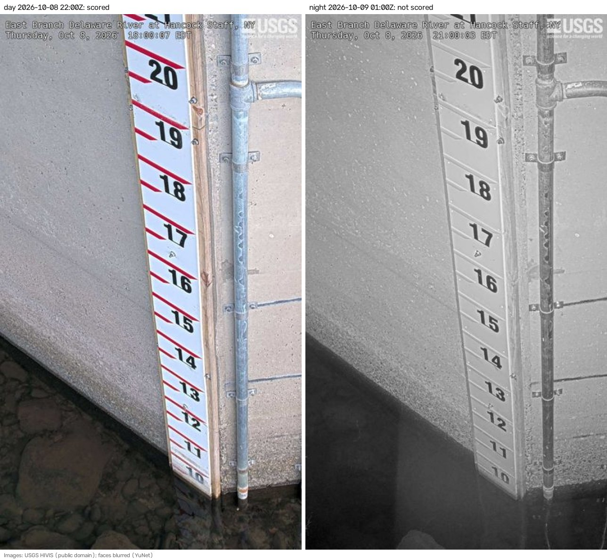
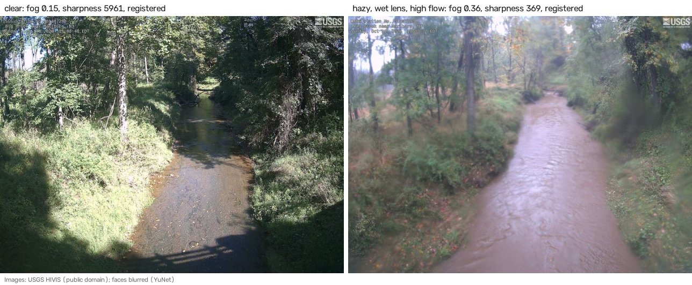
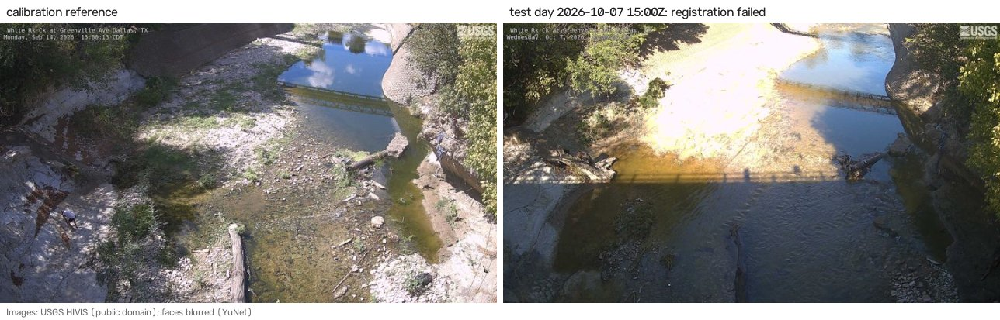
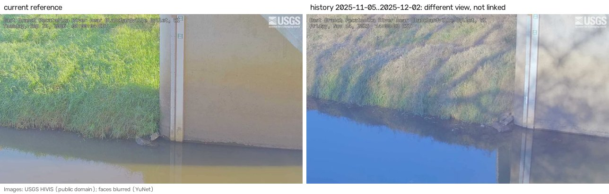
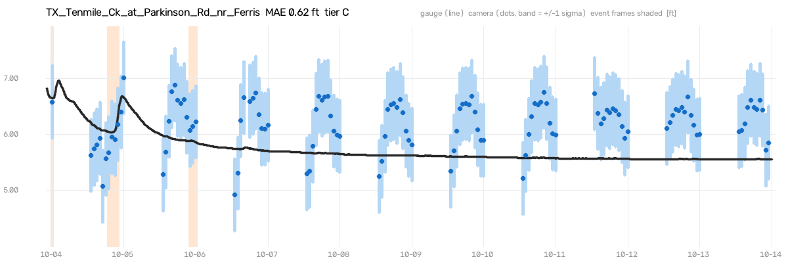
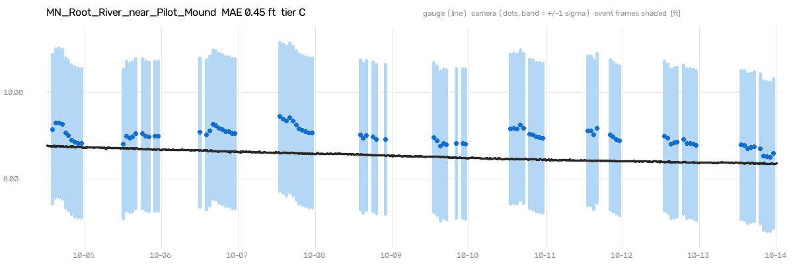
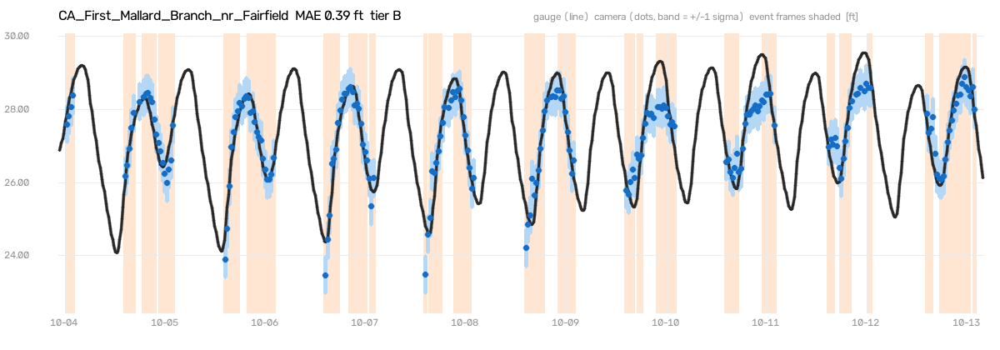
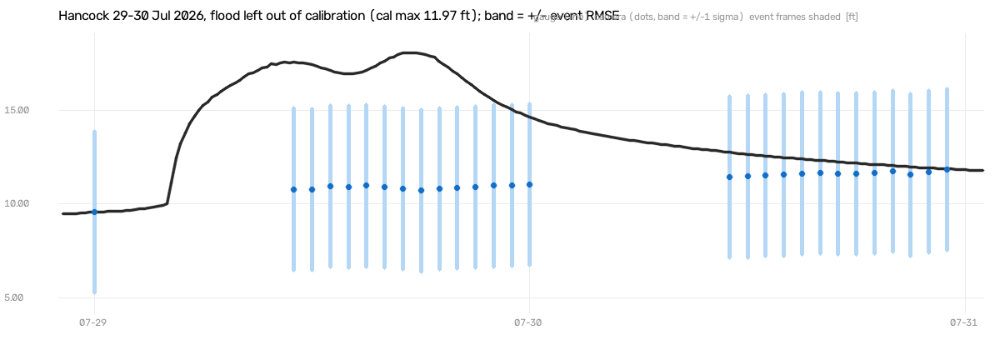
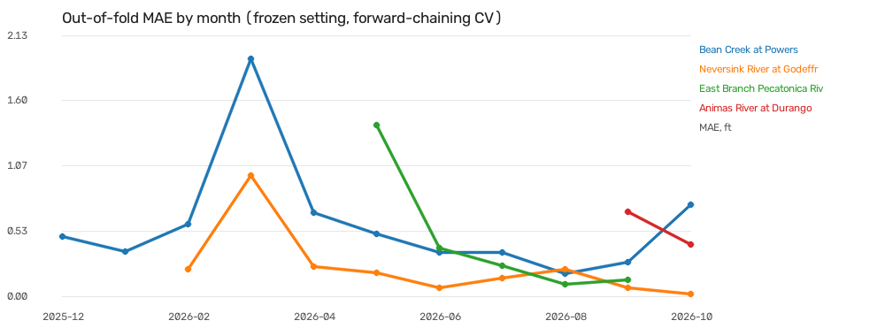

# Failure gallery

Generated by `report/failure_gallery.py`; every number is in `cases.json` or the results file named. Frames: USGS HIVIS, public domain, faces blurred with YuNet.

## 1. Night and IR frames are not scored

44.6 % of all frames in the 30-day window (7256 of 16256) were taken with the sun below −3°. Many cameras switch to infrared at night: grey, differently lit and often noisier. The scene model's features (Lab colour and texture) are learned from daylight frames, so night frames get no reading, and the dashboard shows "night" instead of a number. At Hancock the IR frame still shows the staff plate clearly, which is where a plate reader has the advantage.

## 2. A hazy, wet lens on a high-flow day

Big Brook NJ. Sharpness (Laplacian variance) drops from 5961 to 369, and the dark-channel fog score rises from 0.15 to 0.36. The frame still registered. The trouble is that turbid flood water and a fogged lens move the same metrics, so `LOW_QUALITY` can fire on exactly the frames where a reading matters most. The agent therefore checks registration and the gauge trend before discarding a frame. Big Brook registered only 48 % of its test-day daylight frames (58 scored).

## 3. The scene changed after a flood (White Rock Creek, Dallas)

A flood shortly before the test window moved sediment, logs and vegetation. 55 daylight test frames did not register to the calibration reference, test-day registration was 48 %, and MAE was 0.78 ft (fails P1 and P2). The live system flags `VIEW_CHANGE`, and the agent quarantines the camera and opens a recalibration ticket.

## 4. Cameras get re-aimed (Pecatonica River)

The calibration history has 7 periods taken from a view that cannot be registered to the current reference. The one shown (2025-11-05 to 2025-12-02, 138 frames) is tighter and lower. These frames are excluded from calibration. Across the fleet, 8 of 20 cameras have such periods, which is why view-change handling is a core agent job, not an extra.

## 5. The model learned the sun, not the water (Tenmile Creek)

The gauge spans 1.11 ft over the scored test frames, mostly a slow recession, but the camera estimate rises and falls every day with the sun, low in the morning and high at midday. Spearman ρ is -0.10 and MAE 0.62 ft. Some blocks in the region of interest track illumination or shadow, which correlated with stage in the calibration data. Here a 15-minute-old gauge reading is off by 0.004 ft, and even a 6-hour-old one by 0.050 ft. Fixes for a later version: illumination-invariant features, and sun angle as a covariate.

## 6. A far bank with almost no signal (Root River)

The waterline is far from the camera and a foot of stage moves it only a few pixels. Only 327 reliable blocks survive, σ is 1.74 ft, and the estimate sits above the gauge with a steady offset (MAE 0.45 ft) while the river changes by only 0.41 ft. The reported σ is honest; the reading is not useful at this site's resolution.

## 7. Tides compress the range (First Mallard Branch)

A tidal slough with a daily range of several feet (5.18 ft over the test days). The camera follows the tide (ρ 0.93, MAE 0.39 ft, passes P1 on nMAE), but it flattens the peaks and troughs, and low tide often falls at night. Gap-filling is hard here in a different way: a 6-hour-old value is off by 2.16 ft because the tide has turned, and even a 15-minute-old one by 0.15 ft.

## 8. A flood above the calibrated range (Hancock, leave-event-out)

With the 29 July 2026 flood left out of calibration, the highest stage the model had seen was 11.97 ft, and the river peaked at 18.08 ft. The rise happened overnight, when the camera posts no frames; by morning the model read roughly its calibrated ceiling all day. RMSE was 4.32 ft, while the Kalman σ stayed near 0.04 ft, so it was confidently wrong. Flood state was right on 100 % of frames. Lesson: readings near the top of the calibrated range must be reported as "at least this high", with a flag. Report §6.6.

## 9. Seasons drift

Out-of-fold MAE of the frozen setting by month, from year-long forward-chaining CV (`seasonal_monthly_mae.csv`). A single camera's error can change several-fold from one month to the next (Bean Creek and Neversink both jump in March 2026, then recover). The fleet's monthly median moves between 0.142 and 0.445 ft without a clean seasonal curve, partly because the set of cameras with history grows through the year. The year-long median (0.38 ft) is about twice the test-day median (0.182 ft). Two effects are confounded: the scene changing with the season, and early folds training on only a month or two of data. Periodic recalibration of the live models is the mitigation.
